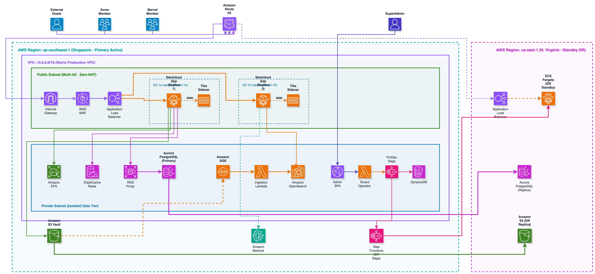

<p align="center">
  <picture>
    <source media="(prefers-color-scheme: dark)" srcset="images/storix-logo-white.png">
    
  </picture>
</p>

# Storix Documentation

Mintlify-powered documentation site for the **Storix** enterprise multi-tenant Nextcloud SaaS platform on AWS.

<p align="center">
  
</p>

---

## 📂 Structure

```
.
├── docs.json                   # Mintlify configuration (navigation, branding, colors)
├── index.mdx                   # Homepage introduction & quick navigation
├── docs/                       # Core platform documentation (MDX)
│   ├── introduction.mdx        # Platform architecture, tenants & key capabilities
│   ├── architecture-overview.mdx # Full-stack AWS architecture & zoom block breakdown
│   ├── quickstart.mdx          # End-to-end setup & initial tenant provisioning
│   ├── project-defense-qa.mdx  # Comprehensive 12-topic architecture defense questions & answers
│   ├── deployment/             # Deployment guides, prerequisites & GitHub Actions
│   │   ├── prerequisites.mdx
│   │   ├── github-actions.mdx
│   │   ├── pipeline-architecture.mdx # 6-block CloudFormation pipeline & 8-stage destroy
│   │   ├── local-cli.mdx
│   │   └── verification.mdx
│   ├── tenants/                # Multi-tenant provisioning & lifecycle operations
│   │   ├── provisioning.mdx
│   │   ├── lifecycle.mdx
│   │   ├── isolation-model.mdx
│   │   └── suspension-resumption.mdx
│   ├── control-plane/          # SuperAdmin Console, Step Functions, Async OCC & Observability
│   │   ├── super-admin-console.mdx
│   │   ├── ssm-runbook.mdx
│   │   ├── dynamodb-registry.mdx
│   │   └── cloudwatch.mdx
│   └── ai/                     # Bedrock AI integration & OpenSearch RAG pipeline
│       ├── bedrock-integration.mdx
│       ├── litellm-bridge.mdx
│       └── rag-pipeline.mdx
├── images/                     # Architecture diagrams, screenshots & icons
│   ├── storix_system_architecture_master.png
│   ├── zoom_block_1_ingress_security.png
│   ├── zoom_block_2_compute_container.png
│   ├── zoom_block_3_data_storage.png
│   ├── zoom_block_4_control_plane_finops.png
│   ├── zoom_block_5_genai_rag.png
│   ├── storix_deployment_pipeline.png
│   ├── storix_process_destroy.png
│   ├── storix_gap_roadmap_minimalist.png
│   ├── nextcloud_features_minimalist.png
│   ├── actors_rbac_hierarchy.png
│   ├── tenant_usecase_architecture.png
│   ├── tenant_lifecycle_statechart.png
│   ├── tenant_feature_architecture.png
│   ├── 01_console_login_page.png
│   ├── 02_console_tenants_light.png
│   ├── 03_console_tenants_dark.png
│   ├── 04_live_unified_search_results.png
│   ├── 12_nextcloud_ai_assistant_chat.png
│   ├── 15_superadmin_tenants_page.png
│   └── 16_superadmin_dashboard_metrics.png
└── public/
    └── llms.txt                # AI agent discovery sitemap (llmstxt.org standard)
```

---

## 🚀 Local Development

### 1. Install Mintlify CLI

```bash
npm i -g mint
```

### 2. Preview Locally

```bash
mint dev
# Opens documentation server at http://localhost:3000
```

### 3. Validate Links & Schema

```bash
mint validate
mint broken-links
```

---

## 🔗 Related Repositories

- [**`FilestoreCloud/infra`**](https://github.com/FilestoreCloud/infra): Modular CloudFormation IaC, Step Functions SAGAs & Lambda Control Plane.
- [**`FilestoreCloud/runtime`**](https://github.com/FilestoreCloud/runtime): Docker Golden Image, Bedrock AI Sidecar, Apache Tika & AWS SOCI indexing.
- [**`FilestoreCloud/console`**](https://github.com/FilestoreCloud/console): Super Admin Web Console (React 18 + Refine + Ant Design + WebAuthn).
- [**`FilestoreCloud/reports`**](https://github.com/FilestoreCloud/reports): Sprint reports, threat models & verification evidence.

---

## License

Documentation is licensed under the [MIT License](LICENSE).
