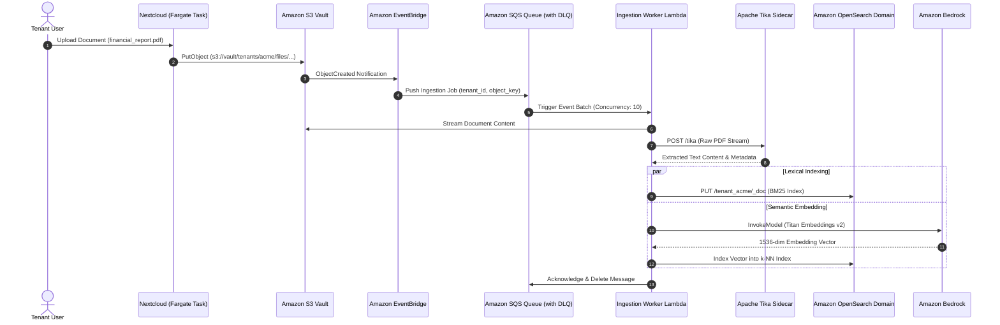

# Generative AI & OpenSearch RAG Pipeline

Storix implements an enterprise-grade **Retrieval-Augmented Generation (RAG)** and full-text search pipeline. By combining **Amazon OpenSearch 2.11** for lexical BM25 indexing with **Amazon Bedrock (Titan Embeddings & Claude 3.5 Sonnet)** for semantic search and generation, users can perform instant keyword lookups and conversational document Q&A without data leaving their private VPC boundary.

---

## 1. Pipeline Architecture

### Key Architectural Components

| Stage | Component | Responsibility |
|---|---|---|
| **1. Change Notification** | Amazon S3 + EventBridge | S3 triggers `ObjectCreated` events when users upload or modify documents in the tenant's S3 vault prefix (`s3://vault/tenants/<tenant_id>/*`). |
| **2. Buffer & Reliability** | Amazon SQS + Dead-Letter Queue (DLQ) | Ingestion events are queued in SQS to absorb traffic bursts and protect downstream indexing services. Poison messages are quarantined in DLQ after 3 retries. |
| **3. Content Extraction** | Apache Tika Sidecar (`127.0.0.1:9998`) | Containerized text parsing engine extracts raw text and metadata from PDF, DOCX, XLSX, PPTX, and HTML files. |
| **4. Lexical Search** | Amazon OpenSearch 2.11 | Stores inverted indexes in tenant-isolated indices (`tenant_<tenant_id>`). Supports BM25 scoring, fuzzy matches, and phrase highlighting. |
| **5. Vector Embeddings** | Amazon Bedrock Titan Text Embeddings | Generates dense 1,536-dimensional vector embeddings for semantic document search. |
| **6. GenAI Inference** | Amazon Bedrock Claude 3.5 Sonnet | Ingests retrieved document snippets and generates contextual answers via LiteLLM loopback sidecar (`127.0.0.1:4000`). |

---

## 2. Asynchronous Ingestion & Indexing Flow

---

## 3. Live Verified Search & Assistant Experience

<Tabs>
  <Tab title="Unified Search Results">
    
    *Real-time search across tenant files with filename matching, content snippets, and highlighted keywords powered by Amazon OpenSearch 2.11.*
  </Tab>
  <Tab title="AI Assistant Q&A Chat">
    
    *In-browser chat modal with `@assistant` grounded in uploaded tenant documents via Claude 3.5 Sonnet.*
  </Tab>
  <Tab title="AI Work with Text">
    
    *Integrated writing assistant providing summarization, tone adjustment, and translation inside Nextcloud Text documents.*
  </Tab>
  <Tab title="Admin AI Settings">
    
    *Administrative configuration for AI providers, rate limits, and model routing via the SuperAdmin Console.*
  </Tab>
</Tabs>

---

## 4. OpenSearch Compatibility Patches

Standard Nextcloud `fulltextsearch_elasticsearch` assumes a traditional Elasticsearch cluster and sends type-based mappings and cluster health queries that are incompatible with Amazon OpenSearch 2.11. 

Storix applies automated pre-baked compatibility patches in the Golden Runtime Image:
1. **Typeless Mappings:** Strips obsolete `_type` mappings from indices to comply with OpenSearch 2.x REST specifications.
2. **Elasticsearch ProductCheckTrait Patch:** Disables the proprietary Elasticsearch version header check (`ProductCheckTrait.php`) that would otherwise reject OpenSearch domains.
3. **Keyword Query Sanitization:** Rewrites wildcards in search queries to utilize OpenSearch `keyword` sub-fields for exact string and path matching.

---

## 5. Security & Isolation Guarantees

<CardGroup cols={2}>
  <Card title="Tenant-Isolated Indices" icon="lock">
    Documents are partitioned into separate indexes (`tenant_<tenant_id>`). Search queries enforce strict index-level RBAC, preventing any cross-tenant data leakage.
  </Card>
  <Card title="Private Loopback Communication" icon="shield">
    LiteLLM and Apache Tika listen exclusively on `127.0.0.1`. Requests never traverse the public internet and require AWS IAM SigV4 credentials.
  </Card>
  <Card title="Zero Model Training on Customer Data" icon="user-secret">
    Amazon Bedrock contracts strictly prohibit customer inputs and outputs from being used to train foundation models.
  </Card>
  <Card title="Dead-Letter Queue Resilience" icon="rotate-right">
    Malformed or encrypted documents failing text extraction are redirected to the SQS DLQ for operator inspection without stalling the main ingestion pipeline.
  </Card>
</CardGroup>
