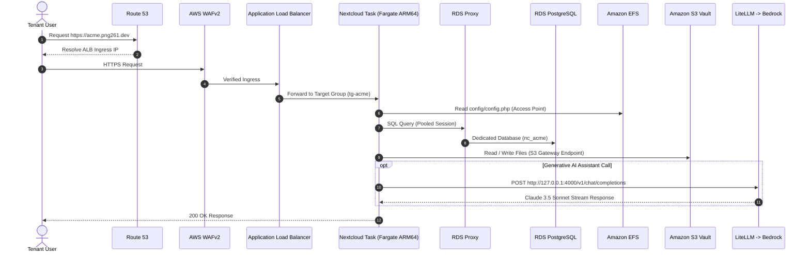

# Architecture Overview

Storix is built upon a **Zero-Code-Modification**, fully AWS-native modular CloudFormation architecture. The platform decouples compute, storage, relational data, and background queue operations to achieve high availability, strict multi-tenant isolation, and FinOps efficiency.

---

## 1. Cloud Infrastructure Architecture


### Key Architectural Layers

| Layer | AWS Service | Design & Responsibility |
|---|---|---|
| **Ingress & Security** | AWS WAFv2 + ALB (Multi-AZ) | OWASP Core rules, rate-limiting, TLS 1.3 termination, and host-header priority routing (`<tenant_id>.png261.dev`). |
| **Compute Engine** | Amazon ECS Fargate | Container-per-tenant isolation with native **AWS Graviton ARM64** optimization. Scale-to-zero compute when suspended. |
| **Connection Pooling** | Amazon RDS Proxy | Managed connection pooling with Secrets Manager integration; prevents database connection spikes during multi-tenant scaling. |
| **Relational Database** | Amazon RDS PostgreSQL 16 | Dedicated catalog (`nc_<tenant_id>`) per tenant, isolated in private subnets with KMS encryption. |
| **Configuration Store** | Amazon EFS | `/tenants/<tenant_id>/config` via dedicated EFS Access Points (POSIX UID/GID 33:33). Lifecycle: 30d IA, 90d Archive tier. |
| **Object Storage Vault** | Amazon S3 Vault Bucket | `s3://vault/tenants/<tenant_id>/...` with S3 Intelligent-Tiering, automated 180-day Glacier Instant Retrieval, and EventBridge notifications. |
| **Dedicated Cron Runner**| Amazon EventBridge Scheduler | Decoupled `rate(5 minutes)` event rule triggering isolated ECS Run-Task for Nextcloud background jobs (`cron.php`). |
| **AI Assistant Engine** | Amazon Bedrock + LiteLLM | Dual-container sidecar architecture proxying Claude 3.5 Sonnet over `127.0.0.1:4000` via IAM SigV4 authentication. |
| **Cold Start Acceleration** | AWS SOCI Indexing | Seekable OCI indices pre-generated in Docker build pipelines for sub-15s Fargate task startup. |
| **24/7 SLA Probing** | CloudWatch Synthetics Canary | Continuous round-the-clock endpoint probes validating latency, HTTP status codes, and response body integrity. |

---

## 2. SuperAdmin Control Plane Architecture


### Control Plane Components

- **Edge Delivery & WAF:** Amazon CloudFront distribution fronted by AWS WAF with Origin Access Control (OAC) to an S3 static web bucket.
- **Biometric & MFA Authentication:** Native **WebAuthn / Passkeys** (Touch ID, Face ID, FIDO2 credentials) and RFC 6238 TOTP MFA with short-lived session tokens and `HttpOnly; SameSite=Strict` cookies.
- **Smart Polling Engine:** Custom React hooks (`usePageVisibility`, `useSmartInterval`) automatically halt background polling when the browser tab is hidden and throttle polling frequency after 2 minutes of inactivity.
- **Async OCC Command Engine:** Long-running administrative operations (`files:scan`, `db:add-missing-indices`) are executed asynchronously via `EXECUTE_OCC_ASYNC` and tracked via `CHECK_OCC_JOB`, avoiding API Gateway 29s timeouts.
- **Step Functions SAGAs:** Orchestrates tenant provisioning, suspension, resumption, and deprovisioning with automated compensating rollbacks on partial failure.
- **Audit Ledger:** Append-only DynamoDB audit log table with 1-year TTL and CloudWatch Log Group retention.

---

## 3. CloudFormation Modular Map

```
infra/modules/
├── 01-networking/     → VPC (10.0.0.0/16), Dual-AZ Public & Private Subnets, S3 Gateway Endpoint
├── 02-security/       → Security Groups (ALB, ECS, RDS, EFS, RDS Proxy), KMS Keys, IAM Execution Roles
├── 03-storage/        → Amazon EFS (30d IA · 90d Archive Lifecycle) & Amazon S3 Vault (Intelligent-Tiering · Glacier)
├── 04-database/       → Amazon RDS PostgreSQL 16 Multi-AZ & Amazon RDS Proxy Connection Pooler
├── 05-compute/        → Amazon ECS Fargate Cluster (Graviton ARM64 / X86_64), ALB Ingress & EventBridge Cron Rule
├── 06-superadmin/     → Step Functions SAGAs, Control Plane Lambda, DynamoDB Registry, WebAuthn & Async OCC
└── 07-observability/  → CloudWatch Synthetics Canary (24/7 SLA), Telemetry Dashboard & Metric Alarms
```

---

## 4. Multi-Tenant Isolation Model

<Warning>
  Cross-tenant access is strictly prohibited across all infrastructure layers. Every tenant strictly maintains:
  - **ECS Fargate Service**: `service-<tenant_id>` with dedicated target group and task definition.
  - **Database Catalog**: `nc_<tenant_id>` in RDS PostgreSQL.
  - **EFS Access Point**: Dedicated POSIX access point enforcing UID/GID 33 (`www-data`).
  - **S3 Storage Prefix**: `s3://<vault>/tenants/<tenant_id>/*` protected by IAM policies.
</Warning>

### Container Task Layout

```
Fargate Task: nc-<tenant_id>
├── nextcloud (PHP-FPM / Apache)     → Port 80 (routed from ALB target group)
│   ├── Config mount                 ← EFS Access Point: /tenants/<tenant_id>/config
│   ├── Primary ObjectStore          ← S3 Gateway Endpoint: s3://<vault>/tenants/<tenant_id>/
│   └── Database connection          ← Amazon RDS Proxy: proxy.<region>.rds.amazonaws.com
└── litellm-bridge (sidecar)         → 127.0.0.1:4000 (Localhost loopback only)
    └── Amazon Bedrock SigV4 API     ← Claude 3.5 Sonnet
```

---

## 5. End-to-End Request Flow


