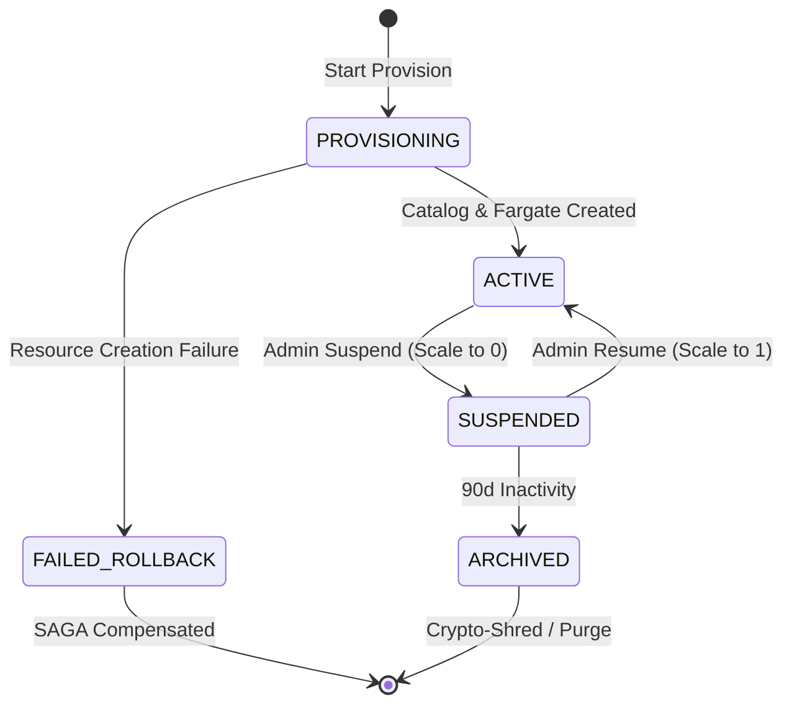
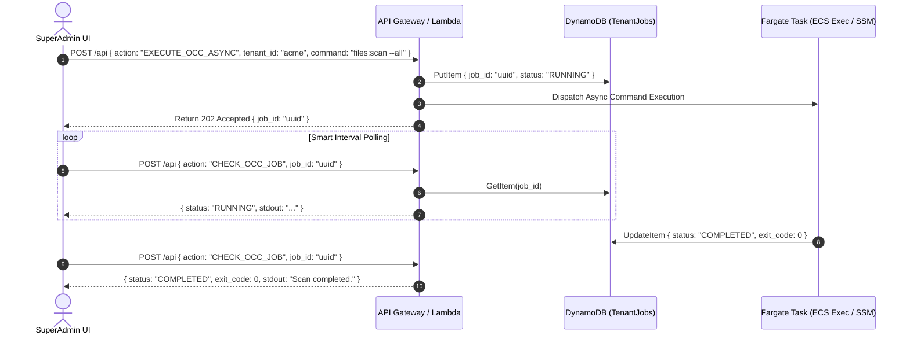

# Orchestration & Step Functions SAGAs

Tenant lifecycle workflows in Storix are orchestrated using **AWS Step Functions Distributed State Machines** paired with **Compensating SAGAs**, eliminating human error and manual SSH or bastion host intervention.

---

## 🔄 Lifecycle Micro-Workflows

Storix provisions dedicated State Machines in module `06-superadmin` for every lifecycle transition:



### Supported Lifecycle Actions

| Action | Execution Engine | Description | Rollback SAGA |
|---|---|---|---|
| `PROVISION` | Step Functions | Creates EFS access points, PostgreSQL catalog, registers task definition, launches Fargate service, and binds ALB rules. | Purges created database catalog, EFS AP, and deletes task definition on failure. |
| `SUSPEND` | Lambda / Step Functions | Updates DynamoDB state to `SUSPENDED`, removes ALB priority routing rule, and sets Fargate `desiredCount: 0`. | Re-enables ALB rule and sets `desiredCount: 1`. |
| `RESUME` | Lambda / Step Functions | Updates DynamoDB state to `ACTIVE`, rebinds ALB priority rule, and sets Fargate `desiredCount: 1`. | Restores suspended state if container fails boot checks. |
| `DEPROVISION` | Step Functions | Cleans up ECS service, deletes ALB rule, archives S3 prefixes, and unregisters EFS access point. | State retained in DynamoDB audit log. |

---

## ⚡ Async OCC Command Job Engine

Heavy administrative operations (e.g. scanning thousands of files or updating database indices) would hit API Gateway's strict 29-second timeout limit if executed synchronously.

Storix solves this with an asynchronous job queue architecture:



### CLI Execution via AWS SDK

```bash
# Execute Async OCC command via Control Plane API
curl -X POST https://admin.png261.dev/api \
  -H "Authorization: Bearer <TOKEN>" \
  -H "Content-Type: application/json" \
  -d '{
    "action": "EXECUTE_OCC_ASYNC",
    "tenant_id": "acme",
    "command": "files:scan --all"
  }'
```
