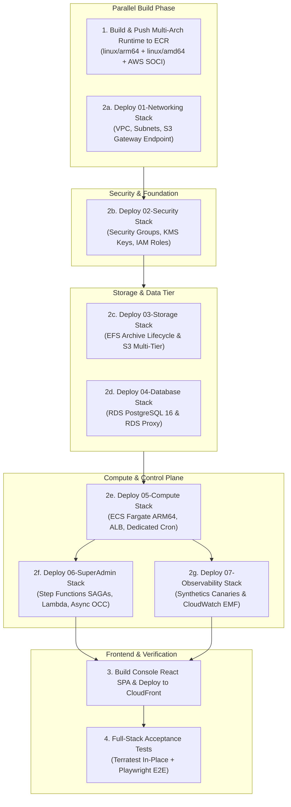

# GitHub Actions CI/CD Pipelines

All platform deployments, runtime container builds, console frontend updates, and infrastructure destructions are fully automated via **Native GitHub Actions CI/CD** in [`FilestoreCloud/infra`](https://github.com/FilestoreCloud/infra) using secure **AWS IAM OpenID Connect (OIDC)** authentication (zero static credentials).

---

## 🚀 Full Platform Deployment (`deploy-all.yml`)

The `deploy-all.yml` workflow orchestrates a 10-stage end-to-end deployment across all layers:



### Triggering via GitHub CLI

```bash
gh workflow run deploy-all.yml \
  --repo FilestoreCloud/infra \
  -f environment=dev \
  -f skip_runtime_build=false \
  -f run_acceptance_tests=true
```

---

## 💥 Zero-Cost Infrastructure Teardown (`destroy.yml`)

To achieve true **$0.00 idle cost** when testing or decommissioning an environment, `destroy.yml` tears down all provisioned resources in reverse dependency order:


### Triggering Teardown via GitHub CLI

```bash
gh workflow run destroy.yml \
  --repo FilestoreCloud/infra \
  -f environment=dev \
  -f confirm_destruction=DESTROY
```

<Warning>
  Teardown purges all database tables, EFS access points, and test S3 buckets. Always verify you are targeting the appropriate environment before providing `confirm_destruction=DESTROY`.
</Warning>
