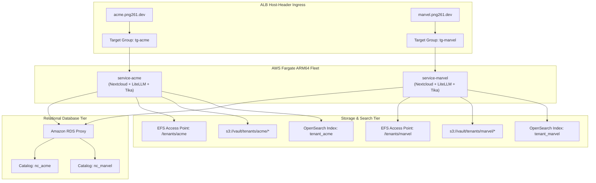

# Multi-Tenant Isolation Model

Storix enforces a **DEDICATED_INSTANCE** architectural paradigm. Rather than multiplexing customer data within a shared application process, every tenant is allocated dedicated, isolated compute containers, database catalogs, storage mount points, and search indices.

  

---

## 🛡️ Multi-Layer Isolation Matrix

| Layer | AWS Service | Isolation Mechanism | Guarantee |
|---|---|---|---|
| **Compute** | Amazon ECS Fargate | Dedicated task (`service-<tenant_id>`) per tenant on AWS Graviton ARM64. | Zero CPU/RAM cross-talk; process boundary enforcement. |
| **Connection Pooling** | Amazon RDS Proxy | Dedicated connection pool per tenant pointing to isolated physical catalogs. | Prevents connection starvation across tenants. |
| **Relational Data** | Amazon RDS PostgreSQL 16 / Aurora Global | Dedicated database catalog (`nc_<tenant_id>`) with isolated schema and user credentials. | Full SQL table and row data separation. |
| **Configuration** | Amazon EFS | Dedicated Access Point scoped to `/tenants/<tenant_id>/config` with POSIX UID/GID 33:33. | POSIX kernel-level path isolation. |
| **Object Storage** | Amazon S3 Vault | Dedicated prefix `s3://<vault>/tenants/<tenant_id>/*` with IAM prefix policies. | Cryptographic and path-based isolation. |
| **Search Indices** | Amazon OpenSearch 2.11 | Dedicated tenant index (`tenant_<tenant_id>`) with isolated BM25 token space. | Zero cross-tenant search hit leakage. |
| **Network Ingress** | ALB + AWS WAFv2 | Dedicated Target Group (`tg-<tenant_id>`) bound to tenant Host-Header. | Clean routing without hostname collision. |

---

## 🔒 Architectural Boundaries

