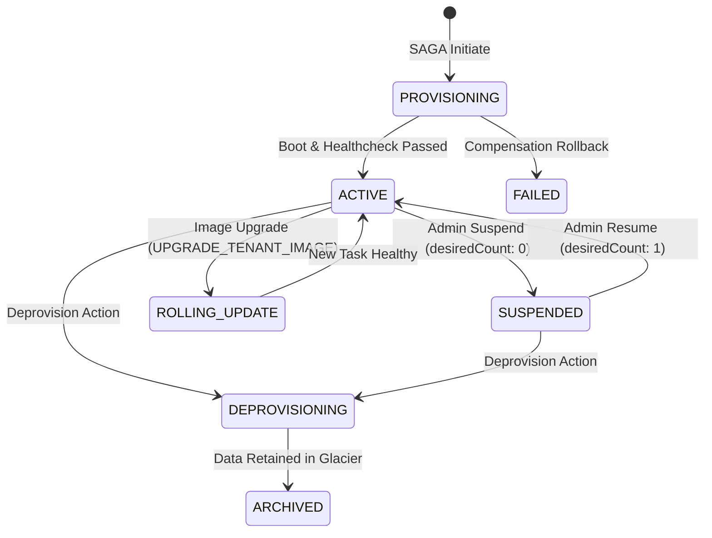

# Tenant Lifecycle Management

Storix manages the entire tenant lifecycle deterministically, ensuring that scaling, rolling updates, and hibernation maintain high availability and zero data loss.

<p align="center">
  
</p>

---

## 🔄 Lifecycle State Machine



---

## 🚀 Zero-Downtime Rolling Image Upgrade

When a new Nextcloud container image is pushed to ECR or a security patch is applied, operators can upgrade individual tenants or the entire fleet without downtime:

```bash
curl -X POST https://admin.png261.dev/api \
  -H "Authorization: Bearer <ADMIN_TOKEN>" \
  -H "Content-Type: application/json" \
  -d '{
    "action": "UPGRADE_TENANT_IMAGE",
    "tenant_id": "acme",
    "image": "649519997247.dkr.ecr.ap-southeast-1.amazonaws.com/dev-nextcloud-enterprise:latest"
  }'
```

### ECS Rolling Update Guarantee

1. ECS provisions the new task using AWS SOCI cold-start indexing (&lt; 15s).
2. The ALB target group executes healthchecks against `/status.php` on the new task.
3. Once the new task reports `200 OK`, traffic shifts cleanly.
4. The legacy task drains connections and terminates gracefully.

---

## 📈 Auto-Scaling Policies

Each tenant service can scale dynamically between **1 and 4 tasks** based on real-time load:
- **Target Tracking Metric:** Target CPU utilization of 70% and Memory utilization of 80%.
- **Cooldown Periods:** 60-second scale-out cooldown, 300-second scale-in cooldown to prevent flapping.
- **Connection Drainage:** ALB target groups enforce 30-second deregistration delay for active WebDAV file transfers.
