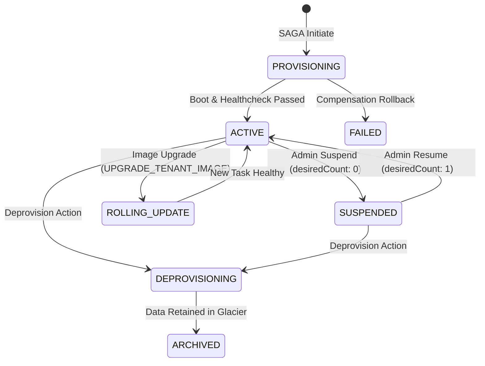

# Tenant Lifecycle Management

Storix manages the entire tenant lifecycle deterministically, ensuring that scaling, rolling updates, and hibernation maintain high availability and zero data loss.

---

## 🔄 Lifecycle State Machine



---

## 🚀 Zero-Downtime Rolling Image Upgrade

When a new Nextcloud container image is pushed to ECR or a security patch is applied, operators can upgrade individual tenants or the entire fleet without downtime:

```bash
curl -X POST https://admin.png261.dev/api \
  -H "Authorization: Bearer <ADMIN_TOKEN>" \
  -H "Content-Type: application/json" \
  -d '{
    "action": "UPGRADE_TENANT_IMAGE",
    "tenant_id": "acme",
    "image": "165795704301.dkr.ecr.ap-southeast-1.amazonaws.com/dev-nextcloud-enterprise:v2.0.0"
  }'
```

### ECS Rolling Update Guarantee

1. ECS provisions the new task using AWS SOCI cold-start indexing (< 15s).
2. The ALB target group executes healthchecks against `/status.php` on the new task.
3. Once the new task reports `200 OK`, traffic shifts cleanly.
4. The legacy task drains connections and terminates gracefully.

---

## 📈 Auto-Scaling Policy

Each tenant Fargate service is equipped with AWS Application Auto Scaling tracking CPU and memory consumption:

| Parameter | Configured Value | Behavior |
|---|---|---|
| **Minimum Tasks** | `1` task | Active baseline |
| **Maximum Tasks** | `4` tasks | Maximum scale-out ceiling |
| **CPU Target Tracking** | `70%` | Automatically launches additional tasks when exceeded |
| **Memory Target Tracking** | `80%` | Scale-out on memory pressure |
| **Scale-Out Cooldown** | `60 seconds` | Rapid responsiveness to traffic surges |
| **Scale-In Cooldown** | `300 seconds` | Prevents task thrashing |

---

## 🗑️ Safe Deprovisioning & Crypto-Shredding

```bash
# Deprovision tenant compute & routing while preserving database & storage
curl -X POST https://admin.png261.dev/api \
  -H "Authorization: Bearer <ADMIN_TOKEN>" \
  -H "Content-Type: application/json" \
  -d '{
    "action": "DEPROVISION",
    "tenant_id": "acme"
  }'
```

<Note>
  Deprovisioning removes the ECS service, ALB rule, and target group immediately. RDS database catalogs and S3 files are preserved or transitioned into Glacier Vaults according to organizational GDPR data retention policies.
</Note>
