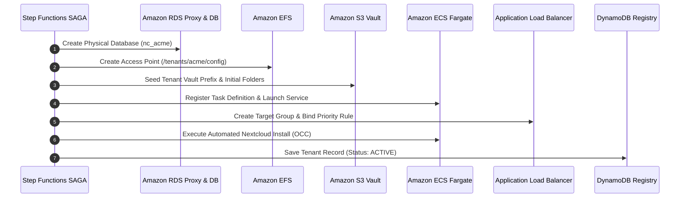

# Tenant Provisioning

Storix provisions new tenants using automated **Step Functions SAGA Micro-Workflows** that orchestrate all cloud resource provisioning with complete isolation.

---

## 🖥️ Via SuperAdmin Console UI

1. Open the **SuperAdmin Console** at `https://admin.png261.dev`.
2. Click the **+ Create Tenant** button in the header or tenants table.
3. Complete the provisioning form:
   - **Tenant ID:** Lowercase alphanumeric identifier (e.g. `acme`).
   - **Organization Name:** Display name (e.g. `Acme Corporation`).
   - **Domain:** Dedicated subdomain (e.g. `acme.png261.dev`).
   - **Admin Email:** Initial organization admin email.
   - **Storage Quota:** Initial storage allocation (e.g. `100 GB`).
4. Click **Submit**. The console tracks live provisioning progress through the Step Functions execution stream.

---

## ⚡ Via Control Plane API

```bash
curl -X POST https://admin.png261.dev/api \
  -H "Authorization: Bearer <ADMIN_TOKEN>" \
  -H "Content-Type: application/json" \
  -d '{
    "action": "PROVISION",
    "tenant_id": "acme",
    "tenant_name": "Acme Corporation",
    "admin_email": "admin@acme.com",
    "domain": "acme.png261.dev",
    "quota_gb": 100
  }'
```

---

## 🔄 Automated SAGA Steps



---

## 📦 Provisioned Resources

| Resource | Identifier / Name Pattern |
|---|---|
| **ECS Fargate Service** | `service-<tenant_id>` (AWS Graviton ARM64) |
| **ALB Target Group** | `tg-<tenant_id>` (Healthcheck: `/status.php`) |
| **EFS Access Point** | Scoped to `/tenants/<tenant_id>/config` (UID/GID 33:33) |
| **RDS Database** | `nc_<tenant_id>` (Managed by RDS Proxy) |
| **S3 Vault Prefix** | `s3://<vault>/tenants/<tenant_id>/*` |
| **DynamoDB Record** | Stored in `<env>-nextcloud-tenant-registry` |
